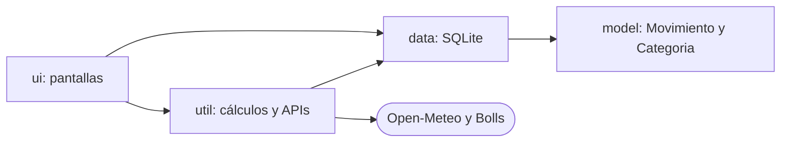
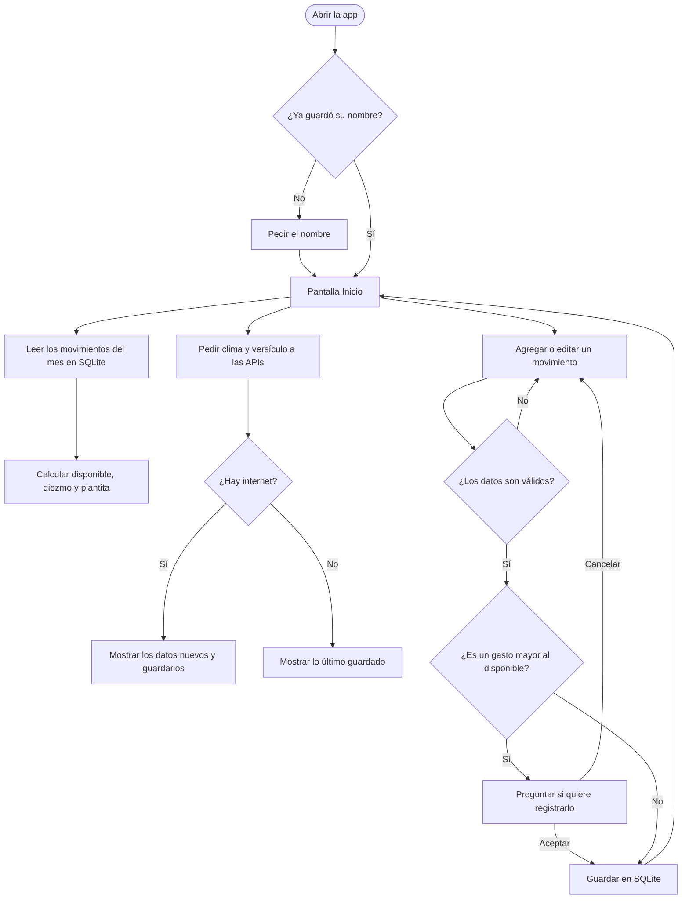

# Control de Gastos

Aplicación Android para llevar el control de mis ingresos y gastos. La hice en **Kotlin**, con los datos guardados en **SQLite** dentro del celular, y le agregué clima y un versículo diario usando dos APIs gratuitas.

**Autor:** _escribe aquí tu nombre_

---

## 1. ¿Qué hace la app?

- Registro **ingresos** y **gastos**, cada uno con monto, categoría, fecha y una descripción opcional.
- Puedo **editar o eliminar** cualquier registro tocándolo.
- Si la categoría que necesito no existe, puedo **crear una propia**.
- Calcula mi **dinero disponible**, y lo que me sobra de un mes pasa al siguiente.
- Aparta el **diezmo** (10% de los ingresos del mes) y lo descuenta de inmediato. Se puede apagar en Ajustes.
- Una **plantita** refleja cómo va el mes: crece y florece si me sobra dinero, y se marchita si gasto de más.
- Una **barra de colores** reparte los ingresos del mes en diezmo, gastos y lo que me queda.
- Si registro un gasto mayor al dinero disponible, me **avisa** y me pregunta si quiero registrarlo.
- El **Historial** me deja ver cualquier mes (sin pasarme del mes actual).
- Me saluda por mi nombre, que me pregunta la primera vez que abro la app.
- Tiene **modo claro y oscuro**.
- Muestra el **clima** de mi ciudad y un **versículo del día** que no se repite.

---

## 2. Tecnologías

| Para qué | Qué usé |
|---|---|
| Lenguaje | Kotlin |
| Pantallas | Vistas con XML y ViewBinding, diseño con Material 3 |
| Base de datos | SQLite, con `SQLiteOpenHelper` |
| Ajustes del usuario | `SharedPreferences` (nombre, tema, diezmo, ciudad) |
| Internet | `HttpURLConnection` y `org.json`, sin librerías externas |
| Trabajo en segundo plano | `Executors` y `Handler` |
| Dibujo de la plantita | `Canvas` (se dibuja con código, sin imágenes) |
| Versión mínima | Android 8.0 (API 26) |

---

## 3. Cómo está organizado el proyecto

```
miumg.edu.gt.controlgastos
├── App.kt                 Aplica el tema guardado al abrir la app
├── model/                 Qué datos existen
│   ├── TipoMovimiento.kt
│   ├── Categoria.kt
│   └── Movimiento.kt
├── data/                  Cómo se guardan
│   └── DatabaseHelper.kt
├── util/                  Cálculos y ayudas
│   ├── Formato.kt         Dinero y fechas
│   ├── Periodo.kt         Rango de cada mes
│   ├── Diezmo.kt          El 10%
│   ├── Preferencias.kt    Ajustes guardados
│   ├── ResumenMes.kt      Barra de colores
│   ├── DisponibleMes.kt   Tarjeta de dinero disponible
│   ├── ListaCategorias.kt Ranking de categorías
│   ├── Bordes.kt          Espacio bajo la barra de estado
│   ├── Clima.kt           API del clima
│   └── Versiculo.kt       API del versículo
└── ui/                    Lo que se ve
    ├── MainActivity.kt
    ├── InicioFragment.kt
    ├── ListaMovimientosFragment.kt  (base de Ingresos y Gastos)
    ├── IngresosFragment.kt
    ├── GastosFragment.kt
    ├── AjustesFragment.kt
    ├── HistorialActivity.kt
    ├── AgregarMovimientoActivity.kt (base)
    ├── AgregarIngresoActivity.kt
    ├── AgregarEgresoActivity.kt
    ├── MovimientoAdapter.kt
    └── PlantaView.kt
```

Separé el código en tres capas para que cada una tenga una sola responsabilidad:



Si cambio el diseño no toco la base de datos, y si cambio la base de datos no toco el diseño.

---

## 4. Diagrama de flujo



Cada vez que vuelvo a la pantalla de Inicio se ejecuta `onResume()`, que vuelve a leer la base de datos. Por eso los números siempre están al día después de guardar algo.

---

## 5. Explicación de cada parte

### model: los datos

| Archivo | Qué hace |
|---|---|
| `TipoMovimiento` | Un `enum` con dos valores: `INGRESO` y `EGRESO`. Evita errores de escritura. |
| `Categoria` | Un `enum` con las categorías de fábrica (Salario, Comida, Transporte, etc.). Cada una sabe si es de ingreso o de gasto. |
| `Movimiento` | Un `data class` con `id`, `tipo`, `monto`, `categoria`, `descripcion` y `fecha`. La categoría es un texto, para poder usar también las que crea el usuario. |

### data: SQLite

`DatabaseHelper` crea y maneja la base de datos (`control_gastos.db`, versión 2):

- Tabla **`movimientos`**: `id`, `tipo`, `monto`, `categoria`, `descripcion`, `fecha`.
- Tabla **`categorias`**: las categorías propias del usuario (nombre y tipo, sin repetidos).
- Guarda, edita, elimina y busca movimientos.
- Calcula totales por tipo y por categoría, siempre dentro de un rango de fechas.
- Al pasar de la versión 1 a la 2 solo agrega la tabla nueva, sin borrar datos.

La fecha se guarda como un número (milisegundos desde 1970), porque SQLite no tiene tipo fecha. Así se puede ordenar y filtrar por rango fácilmente.

### util: cálculos y ayudas

| Archivo | Qué hace |
|---|---|
| `Formato` | Da formato al dinero (`Q 1,620.00`) y a las fechas. También corrige la diferencia de zona horaria del calendario, para que la fecha no se corra un día. |
| `Periodo` | Calcula dónde empieza y dónde termina cada mes. |
| `Diezmo` | Calcula el 10% de los ingresos y lo que queda después. |
| `Preferencias` | Guarda en el celular el nombre, el tema, si el diezmo está activo y la ciudad del clima. |
| `ResumenMes` | Dibuja la barra de colores y escribe la frase de cómo voy. |
| `DisponibleMes` | Llena la tarjeta de dinero disponible del Historial. |
| `ListaCategorias` | Dibuja el ranking de categorías con sus barras. |
| `Bordes` | Agrega espacio para que el encabezado no quede tapado por la barra de estado. |
| `Clima` | Pide el clima a Open-Meteo, busca ciudades y guarda el último resultado. |
| `Versiculo` | Elige y pide el versículo del día a Bolls y lo guarda. |

### ui: las pantallas

| Archivo | Qué hace |
|---|---|
| `MainActivity` | Es el contenedor. Tiene el menú de abajo (Inicio, Ingresos, Gastos, Ajustes) y pregunta el nombre la primera vez. |
| `InicioFragment` | Pantalla principal: dinero disponible, clima, versículo, diezmo, plantita, barra de colores, gastos por categoría y movimientos del mes. |
| `ListaMovimientosFragment` | Muestra la lista de un tipo de movimiento. `IngresosFragment` y `GastosFragment` solo le dicen cuál tipo. |
| `AjustesFragment` | Cambiar el nombre, el tema, la ciudad del clima y activar o apagar el diezmo. |
| `HistorialActivity` | Ver cualquier mes con sus flechas, limitado desde el movimiento más antiguo hasta el mes actual. |
| `AgregarMovimientoActivity` | Pantalla para crear o editar. `AgregarIngresoActivity` y `AgregarEgresoActivity` solo le dicen el tipo. |
| `MovimientoAdapter` | Dibuja cada fila de las listas y avisa cuando la toco. |
| `PlantaView` | Una vista que dibuja la plantita con código y la anima. |

### res: lo visual

- `layout/`: los diseños de las pantallas en XML.
- `drawable/`: fondos, íconos del clima y el ícono de la app.
- `values/colors.xml` y `values-night/colors.xml`: los colores del modo claro y oscuro.
- `values/themes.xml`: el tema y los estilos de tarjetas y botones.
- `menu/menu_principal.xml`: el menú de abajo.

---

## 6. Las reglas de cálculo

**Cada mes empieza en cero.** Un mes va desde el día 1 a las 00:00 hasta el día 1 del mes siguiente, que ya no cuenta.

**Diezmo del mes** = 10% de los ingresos de ese mes. Se descuenta apenas registro el ingreso.

**Dinero disponible** = lo que traigo de meses anteriores + ingresos del mes sin el diezmo − gastos del mes.

**Aviso de gasto de más:** al guardar un gasto, comparo su monto con el dinero disponible hasta el final del mes de su fecha. Si lo supera, la app me pregunta antes de registrarlo.

**La plantita** depende de cuánto me queda de los ingresos del mes, ya sin el diezmo y sin los gastos:

| Lo que me queda | Plantita |
|---|---|
| Aún no hay ingresos | Semilla dormida |
| Más del 70% | Floreciendo |
| Entre 40% y 70% | Creciendo fuerte |
| Entre 15% y 40% | Necesita cuidado |
| Menos del 15% | Muy sedienta |
| Menos de 0 (me pasé) | Marchita |

---

## 7. Las APIs

| Función | API | Cómo la uso |
|---|---|---|
| Clima | [Open-Meteo](https://open-meteo.com) | Pido la temperatura actual, la máxima, la mínima y la probabilidad de lluvia. No necesita clave. La ciudad se busca por nombre con su servicio de geocodificación. |
| Versículo | [Bolls Bible](https://bolls.life) | Elijo al azar un versículo de Salmos, Proverbios, Eclesiastés, Isaías o el Nuevo Testamento. Solo uso los que tienen un tamaño razonable y cierran su idea. Los que ya mostré se apuntan para que **no se repitan**. |

Cómo las cuido:

- Todo lo de internet se hace **en segundo plano**, para que la pantalla nunca se trabe.
- El clima se actualiza como máximo cada **30 minutos**, y el versículo cambia **una vez al día**.
- Lo último que se descargó queda guardado, así que se ve aunque no haya internet.
- Si falla la conexión, la app no se cierra: solo muestra lo último que tenía u oculta esa tarjeta.

---

## 8. Créditos y notas

- Datos del clima: [Open-Meteo.com](https://open-meteo.com), licencia CC BY 4.0.
- Versículos: [Bolls Bible](https://bolls.life), versión Reina-Valera 1960. Esa versión tiene derechos de autor, así que este uso es solo personal o académico. Si la app se publica, hay que cambiarla por una fuente con licencia.
- Íconos del clima, plantita e ícono de la app: dibujados con código en el propio proyecto.
